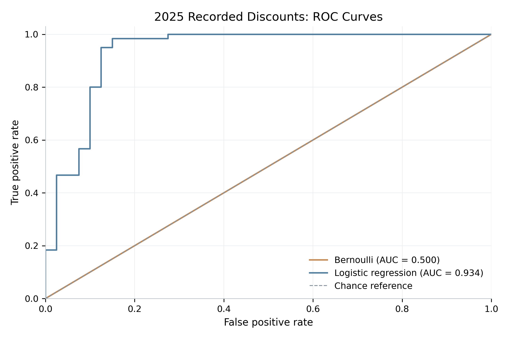
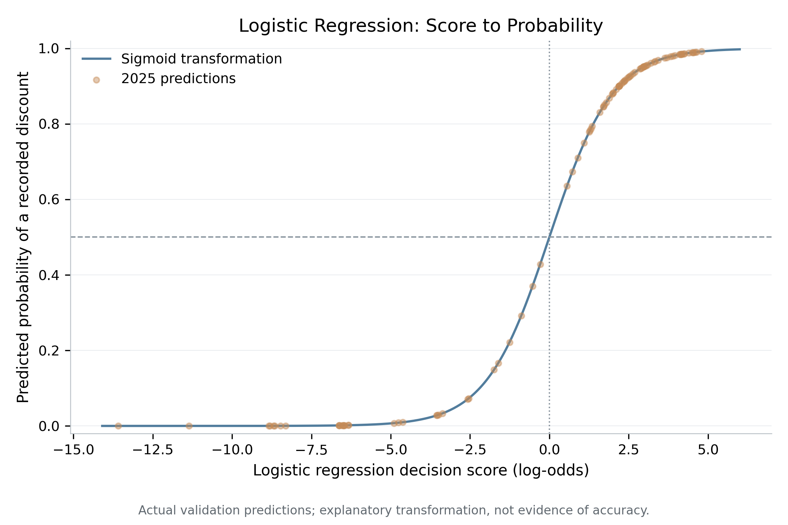
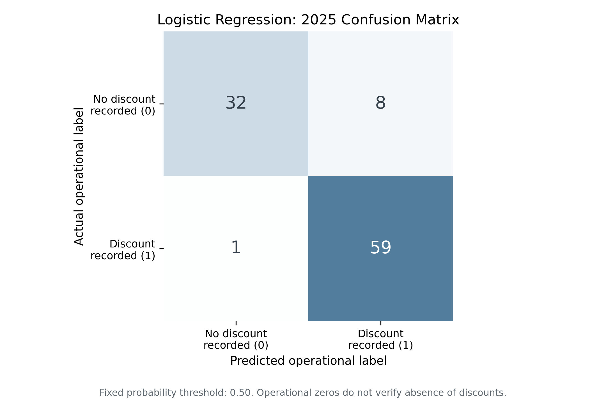

# Steam Autumn Sale Discount Prediction

An independent data science research project investigating whether historical Steam game metadata and pre-sale pricing behavior can predict a recorded Steam-store discount during the Autumn Sale.

The completed experiments compare a constant-probability Bernoulli baseline, logistic regression, Random Forest and XGBoost on a 100-game historical pilot. A separate offline audit assesses sampling and historical-data collection feasibility for larger cohorts. Training uses 2023–2024 observations; validation uses 2025 observations. The target is **recorded discount occurrence**, not independently verified sale participation.

## Research question

Can information about a game before an Autumn Sale begins predict whether a qualifying Steam-store discount will be recorded during that sale?

Each observation represents one game in one sale year. The operational target, `discount_observed`, is `1` when at least one qualifying discount is recorded inside the official sale window and `0` when none is recorded. A zero does not establish that the game remained at full price throughout the event. A recorded discount also does not establish formal enrollment in Valve's seasonal sale program.

## Data and scope

The broader metadata source, `games.csv`, contains **125,855 Steam entries**. Cleaning produces a catalog of **99,194 paid-game candidates**, using valid identifiers, names, release dates and positive source prices. This catalog is distinct from the modeling dataset; the source-price filter does not establish permanent paid or free-to-play status.

The historical pilot contains **100 games** selected for diagnostic diversity across release eras, source-price bands and other sampling characteristics. It is not a representative sample of the Steam catalog. Observing those games in the 2023, 2024 and 2025 Autumn Sales produces **300 game-year observations**, with **175 operational positives and 125 operational negatives**.

### Sources

Game metadata comes from the local `games.csv` snapshot. Its reference date is unknown, so contemporary prices, reviews, ownership and player activity are not used as historical predictors. A known concatenated CSV header is corrected at load time through `src/source_schema.py`; the original source remains unchanged. The companion `games.json` is not used by the completed pipeline. Both source files are Git-ignored, and source-stage reproduction requires a local copy of `games.csv`.

Historical prices come from [IsThereAnyDeal](https://isthereanydeal.com/), collected for Steam shop ID `61`, country `US`, with a requested history start of `2021-01-01T00:00:00Z`. The 100 cached histories contain **5,568 Steam records**; 97 histories are nonempty and three are empty. Original responses and collection provenance are retained under `data/raw/itad/`. Baseline reproduction uses these local artifacts without new pricing requests.

Sale boundaries were verified against official Valve announcements and artwork. The [event calendar](src/autumn_sale_calendar.json) and [evidence audit](reports/autumn_sale_evidence_audit.md) retain the source references.

| Sale year | UTC start, inclusive | UTC end, exclusive |
|---|---|---|
| 2023 | 2023-11-21T18:00:00Z | 2023-11-28T18:00:00Z |
| 2024 | 2024-11-27T18:00:00Z | 2024-12-04T18:00:00Z |
| 2025 | 2025-09-29T17:00:00Z | 2025-10-06T17:00:00Z |

## Methodology

### Labels and historical features

Labels use directly timestamped Steam observations within each half-open sale window. A qualifying discount requires an explicit positive cut percentage and a price below the regular price, with valid amounts and matching currencies. Missing or contradictory deal information remains ambiguous. The labeling rule supports null labels for ambiguous cases; none occur in the current 300-row dataset. Surrounding prices are contextual evidence, without interpolation or carry-forward assumptions.

Predictors are calculated independently of the target using observations strictly before the relevant sale start. Date-derived metadata is included under the assumption that the reported release date is accurate and stable. Modeling uses only the 15 predictors approved in the [feature manifest](reports/autumn_sale_feature_manifest.json):

| Feature group | Predictors |
|---|---|
| Release information | `game_age_days`, `release_year`, `release_month`, `release_quarter` |
| Historical observations | `prior_price_record_count`, `prior_discount_count`, `prior_discount_rate` |
| Recency | `days_since_last_price_record`, `days_since_last_discount` |
| Historical prices and cuts | `max_prior_discount_pct`, `mean_prior_discount_pct`, `last_observed_price`, `last_observed_discount_pct` |
| Coverage indicators | `has_prior_price_history`, `has_prior_discount_observation` |

AppID, sale year and prediction cutoff are linkage or split fields. The target, release-hour audit flag, evidence categories, PU status and current-sale outcomes are excluded from predictors. Counts describe recorded observations, not distinct discount campaigns or discounted durations. The latest observed price is not treated as the price at sale start.

### Evaluation protocol

| Split | Sale years | Observations | Positive | Negative |
|---|---|---:|---:|---:|
| Training | 2023–2024 | 200 | 115 | 85 |
| Validation | 2025 | 100 | 60 | 40 |

The split is chronological, without random mixing across years. Preprocessing and model fitting use training data only. Hyperparameters are fixed initial defaults, with no search or validation-based threshold selection. All four models classify a probability of at least **0.50** as an operational positive.

The same 100 games appear across years. This tests temporal generalization to a later sale for previously represented games, not generalization to entirely unseen games or the full catalog.

### Models

The Bernoulli baseline uses `DummyClassifier(strategy="prior")` to assign every validation observation the training positive rate: **115 / 200 = 0.575**. It uses no game-specific predictors or preprocessing. The validation prevalence of 0.600 is an evaluation reference, not its fitted probability.

Logistic regression uses an explicit sklearn pipeline: approved feature selection, training-only median imputation, StandardScaler and `LogisticRegression(penalty="l2", C=1.0, solver="lbfgs", max_iter=2000, random_state=42)`. Existing historical coverage indicators are retained without additional missingness indicators. No training feature is constant or entirely missing, so all 15 approved predictors are retained. Coefficients describe associations on the transformed feature scale, without causal interpretation.

Random Forest is a predefined nonlinear comparison, using 200 trees, maximum depth 4, minimum leaf size 5, `max_features="sqrt"`, `random_state=42` and `n_jobs=1`. Its complete pipeline selects the same 15 approved predictors and fits a training-only median imputer; tree predictors are not scaled.

XGBoost 2.1.4 uses 100 trees, maximum depth 3, learning rate 0.05, row and column subsampling of 0.8, `objective="binary:logistic"`, `eval_metric="logloss"`, seed 42 and one job. It uses the same training-only median preprocessing, without validation-based early stopping. Its fitted pipeline, predictions, metrics and feature-importance figure are verified. Its dependency is declared in `requirements-ensemble.txt`.

## Results

All four model comparisons use the same 100 observations from 2025. The baseline predictions and metrics are loaded from the approved Phase 7A artifacts rather than retrained. Since this holdout was already inspected, the comparison is not a fresh confirmatory test:

| Model | ROC-AUC | Average precision | Brier score | Accuracy |
|---|---:|---:|---:|---:|
| Bernoulli baseline | 0.500000 | 0.600000 | 0.240625 | 0.600000 |
| Logistic regression | 0.933750 | 0.937660 | 0.075389 | 0.910000 |
| Random Forest | 0.927083 | 0.918201 | 0.081897 | 0.880000 |
| XGBoost | 0.929583 | 0.926240 | 0.067501 | 0.930000 |

Logistic regression improves ranking, probability error and fixed-threshold accuracy over the constant baseline. It has the highest ROC-AUC and average precision in this pilot; XGBoost has the lowest Brier score and highest fixed-threshold accuracy. Higher ROC-AUC, average precision and accuracy are better; lower Brier score is better. This does not establish a universal best model based on accuracy alone. These are pilot results against recorded-discount labels; they do not establish actual participation probabilities or catalog-wide performance. [The evaluation report](reports/autumn_sale_baseline_evaluation.md) includes log loss, precision, recall, F1, coefficient interpretation and calibration diagnostics. Exact baseline metrics are saved in [JSON](reports/autumn_sale_baseline_metrics.json). The [comparative evaluation](reports/autumn_sale_model_comparison.md) and [comparison metrics](reports/autumn_sale_model_comparison_metrics.json) include all available models, all eight metrics and their confusion matrices.



The original baseline ROC curves compare Bernoulli and logistic regression using their actual validation probabilities. The new [comparison ROC figure](reports/figures/model_roc_curves.png) includes Random Forest and XGBoost.



The sigmoid transforms the combined multivariable decision score into a probability. All 100 overlaid points are fitted-model validation predictions. They lie on the curve by construction; this is an explanatory figure, not evidence of predictive accuracy.



Rows are actual operational labels and columns are predicted labels. At the fixed threshold, logistic regression produces 32 true negatives, eight false positives, one false negative and 59 true positives **against the operational labels**.

Additional coefficient, precision–recall, probability-distribution, reliability and Bernoulli-distribution figures are available in [reports/figures/](reports/figures/). All figures use a consistent light-mode style and are exported at 300 DPI.

### Secondary temporal check and coverage diagnostic

A secondary chronological check fits the same available model types on 2023 only and evaluates 2024, using 100 training observations and 100 evaluation observations. The Bernoulli prior is recomputed as 0.55; preprocessing remains training-only. ROC-AUC is 0.500000 for Bernoulli, 0.910833 for logistic regression and 0.892917 for Random Forest and 0.910417 for XGBoost. [Full secondary results](reports/autumn_sale_temporal_robustness.json) are saved separately. Different training sizes and evaluation years prevent interpreting differences as controlled temporal drift. The games recur, and 2024 outcomes contribute to primary training, so this is not an independent confirmatory test.

A post-hoc exploratory coverage-only logistic model uses `prior_price_record_count`, `days_since_last_price_record` and `has_prior_price_history`. Discount-specific counts, recencies and flags are excluded from this narrow availability diagnostic. It achieves ROC-AUC 0.865833, average precision 0.874952, Brier score 0.108245 and accuracy 0.870000 on 2025. This suggests observation availability may contribute to the operational target's predictive signal, without proving its precise source. The [coverage diagnostic](reports/autumn_sale_coverage_sensitivity_modeling.json) does not replace or modify a primary model.

Random Forest [feature importance](reports/figures/random_forest_feature_importance.png) uses native training impurity importance; [XGBoost importance](reports/figures/xgboost_feature_importance.png) uses normalized average split gain. Both include exploratory permutation importance on the previously examined 2025 holdout (ROC-AUC, 20 repeats, seed 42). Correlated predictors can distort both methods; importance is not causal and is not used for feature selection or retuning. New figures cover metric comparisons, ROC/PR curves, confusion matrices, probability distributions, temporal robustness and coverage sensitivity. Their [underlying plotted values](reports/autumn_sale_ensemble_plot_data.json) are saved for verification.

## Historical scaling feasibility

The offline audit of `data/intermediate/games_master.csv` confirms **99,194 unique catalog AppIDs**, with no missing or invalid identifiers or release dates. Existing date-level sale eligibility is **61,681 games for 2023**, **76,256 for 2024** and **90,893 for 2025**. These counts include 23, 47 and 54 release-on-start-day cases respectively; release hours remain unknown.

The restricted balanced historical sampling frame contains **61,559 nonpilot games** released strictly before every sale start date. Seed 42 and release-period stratification produce nested planned totals of **500, 1,000, 2,000 and 5,000 games**, including the separately identified original 100-game pilot. Selection uses reported release information and AppID priorities, not future outcomes, snapshot engagement or evidence abundance. The candidate manifest is a planning artifact; an expanded labeled or modeling dataset does not yet exist.

Local histories remain limited to the pilot: **97 games have price observations, 88 have qualifying discount observations and three histories are empty**. Provider-side coverage for the other **99,094 catalog games** is unknown. Collection estimates, pilot-specific pipeline barriers and a proposed game-disjoint evaluation design are documented in the [feasibility report](reports/autumn_sale_scaling_feasibility.md) and [sampling plan](reports/autumn_sale_sampling_plan.md).

```bash
python3 -B src/10_audit_scaling_feasibility.py --verify
```

The audit uses existing local files and dependencies, without API requests or model fitting. Its [validation receipt](reports/autumn_sale_scaling_validation.json) records 22 passing focused tests, two byte-identical audit runs and preservation of 214 earlier files. Four additional light-mode figures describe catalog releases, observed local evidence, planned sample composition and the sampling population. Collection feasibility remains conditional on quota, matching, response limits and historical provenance; bulk collection requires separate approval.

### Bounded collection preparation

The expansion collector is prepared for a separately approved **20-game trial**. No expansion histories have been retrieved. The trial preserves the first 20 new candidates in the approved ranking: one pre-2015 game, eight from 2015–2019, eight from 2020–2022 and three from 2023 before the sale. Missing histories or failed matches will not trigger replacement sampling or negative-label creation.

Game-level memberships are frozen across all **61,559 eligible nonpilot games**: **49,247 development** and **12,312 sealed evaluation**. An independent SHA-256 priority assigns approximately 80/20 within each release stratum. The trial contains 16 development and four evaluation games; the original pilot remains separate. Held-out AppIDs are rejected from development inputs in every sale year.

```bash
python3 -B src/11_prepare_expansion_collection.py --verify
```

The default command is offline. All **36 focused tests pass**, using mocked HTTP responses and temporary encryption keys. Two isolated verified runs produce byte-identical preparation outputs and preserve all **225 protected earlier files**. The [preflight report](reports/expansion/autumn_sale_smoke_preflight.md) documents the exact cohort, API uncertainties, cache and failure accounting, and proposed future command. Its [approval manifest](reports/expansion/autumn_sale_smoke_approval_manifest.json) remains **PENDING**.

Live mode requires explicit human approval bound to the manifest digest, a **60-attempt cumulative request budget**, and an external custodian's public certificate. Requests would be serial, spaced at least one second, with a 30-second timeout and at most three attempts per game/endpoint across restarts. Evaluation responses must be encrypted before storage. Separate private-key custody and a trusted collection operator are necessary; filesystem permissions and Python guards alone cannot guarantee blindness. Actual custody, current provider quota, matching and historical completeness remain unverified. No API credential is required for preparation, and no dependencies are installed by this workflow.

## Limitations

Historical coverage is incomplete. An absent discount record cannot establish absence of a discount, and models may learn recording coverage as well as discount behavior. The history endpoint is change-oriented; complete capture and price persistence between records have not been established. Independent research did not establish verified full-sale negatives for the diagnostic verification sample.

Filtering timestamps prevents direct use of future observations, but retrospective provider records do not prove that the information was available at the historical prediction time. Backfill, requested-since initialization, release-date corrections and early-access interpretation remain unresolved. Date-level eligibility also leaves a same-day release-hour ambiguity.

The pilot was selected using snapshot information and unequal inclusion probabilities, introducing selection bias. Some catalog entries may be software or other non-game products. Repeated games create dependence across observations, and correlated predictors complicate individual coefficient interpretation. One validation year with only 100 observations provides limited evidence about calibration or performance beyond this sample.

## Reproducibility

Run commands from the repository root. Baseline experiments were verified with Python **3.9.6**, NumPy **2.0.2**, pandas **2.3.3**, scikit-learn **1.6.1**, SciPy **1.13.1**, matplotlib **3.9.4** and joblib **1.5.3**. [requirements-baseline.txt](requirements-baseline.txt) specifies the tested modeling and plotting versions and includes the source-processing requirements from [requirements.txt](requirements.txt). The historical scripts also use Python's standard library and the system IANA timezone database.

### Installation

```bash
python3 -m venv .venv
source .venv/bin/activate
python3 -m pip install -r requirements-baseline.txt
```

For all four ensemble comparisons, `requirements-ensemble.txt` adds XGBoost 2.1.4. The feasibility audit does not require XGBoost or an API credential. Dependency installation requires package access. Once dependencies and the existing local inputs are available, baseline execution is offline and requires no API credential.

### Reproduce the comparative experiments

```bash
python3 -B src/09_train_ensemble_models.py --verify
```

The original baseline command, `python3 -B src/08_train_baseline_models.py --verify`, remains supported. Run earlier artifact-regenerating workflows in a separate working copy when preserving the approved comparison inputs.

The comparison command validates the approved baseline artifacts, fits available ensembles, runs the secondary check and coverage/importance diagnostics, generates figures and reports, and verifies two complete isolated executions. It saves only new comparison outputs and checks protected-input hashes. It does not regenerate earlier datasets or refresh price histories. Verification blocks socket and DNS access.

For the focused tests:

```bash
python3 -B -m unittest discover -s tests -p 'test_baseline_models.py'
python3 -B -m unittest discover -s tests -p 'test_ensemble_models.py'
```

The [ensemble validation receipt](reports/autumn_sale_ensemble_validation.json) records **201 passing tests**, with no failures, errors or skips, using XGBoost 2.1.4. Repeated predictions, metrics, model fingerprints, secondary/diagnostic results, plotted data, PNG bytes and both ensemble artifact bytes are identical in the recorded environment. All **186 protected earlier files**, including every Phase 7A output and existing figure, remain unchanged. `requirements-ensemble.txt` declares the optional XGBoost dependency; this offline workflow does not install it.

The saved [validation receipt](reports/autumn_sale_baseline_validation.json) records **171 passing offline tests**, including 35 baseline tests. It verifies identical predictions, metrics, fitted parameters, plotted data, PNG bytes and model bytes across repeated runs in the recorded environment, plus unchanged hashes for **166 protected earlier files**. Cross-platform numerical or image-byte identity and cross-version joblib compatibility are not guaranteed. Load only trusted local joblib artifacts.

<details>
<summary>Earlier data preparation and evidence workflows</summary>

With the original `games.csv` available, the supported source-processing entry points are:

```bash
python3 src/00_inspect_source.py
python3 src/01_build_games_master.py
python3 src/02_create_pilot.py
```

The inspection prints diagnostics; master and pilot scripts regenerate intermediate datasets and reports. Use a separate working copy when rebuilding stages whose outputs are protected by later experiments.

Historical collection requires `ITAD_API_KEY` in the process environment. The collector does not read the local `apikey` file or automatically load `.env`. Its smoke and full collection commands are:

```bash
python3 src/03_fetch_itad.py --limit 3
python3 src/03_fetch_itad.py
```

The full run requires a valid three-game smoke receipt. These commands can make pricing API requests and are unnecessary for reproducing the cached experiments. The collector's `--validate-cache` mode makes no API calls but rewrites collection artifacts; it is not a read-only check of the frozen inputs.

The cached evidence, coverage, reviewed verification ledger, labels and features have these supported offline entry points:

```bash
python3 src/04_audit_autumn_evidence.py
python3 src/05_investigate_sale_coverage.py --verify
python3 -B src/06_verify_historical_ground_truth.py --verify
python3 -B src/06_build_operational_labels.py --verify
python3 -B src/07_build_autumn_features.py --verify
```

These workflows regenerate their own outputs. The ground-truth verification script uses the reviewed local research ledger rather than repeating external research. Detailed input requirements and validation records are retained in their corresponding reports.

The complete test suite can also be run independently:

```bash
python3 -m unittest discover -s tests -v
```

</details>

## Repository structure

```text
.
├── data/raw/itad/          # Cached historical price responses and provenance
├── data/intermediate/     # Catalog, pilot, evidence, labels and historical features
├── data/processed/        # 2025 baseline and ensemble validation predictions
├── models/                # Complete fitted baseline and ensemble pipelines
├── reports/               # Research reports, manifests and validation receipts
│   ├── figures/           # Static evaluation and scaling-audit figures
│   ├── sources/           # Reviewed source notes and official calendar artwork
│   └── baselines/         # Preserved earlier evidence-audit convention
├── src/                   # Data workflows, modeling and reusable plotting style
├── tests/                 # Offline unit, integration and adversarial tests
├── requirements.txt
├── requirements-baseline.txt
├── requirements-ensemble.txt
├── PROJECT_CONTEXT.md
└── PROJECT_STATUS.md
```

The main modeling artifacts are:

| Artifact | Path |
|---|---|
| Operational targets and provenance | `data/intermediate/autumn_sale_operational_labels.csv` |
| Predictor-only table | `data/intermediate/autumn_sale_features.csv` |
| Modeling table | `data/intermediate/autumn_sale_modeling_table.csv` |
| Approved feature definitions | `reports/autumn_sale_feature_manifest.json` |
| Validation predictions: 100 games × two models | `data/processed/autumn_sale_2025_baseline_predictions.csv` |
| Fitted constant-prior estimator | `models/bernoulli_baseline.joblib` |
| Complete fitted logistic pipeline | `models/logistic_regression.joblib` |
| Model configuration, preprocessing and versions | `reports/autumn_sale_baseline_model_manifest.json` |
| Underlying baseline plotted values | `reports/autumn_sale_baseline_plot_data.json` |
| Ensemble validation predictions | `data/processed/autumn_sale_2025_ensemble_predictions.csv` |
| All available model predictions | `data/processed/autumn_sale_2025_model_comparison_predictions.csv` |
| Complete fitted Random Forest pipeline | `models/random_forest.joblib` |
| Complete fitted XGBoost pipeline | `models/xgboost_model.joblib` |
| Scaling candidates (planning only) | `data/intermediate/autumn_sale_scaling_candidates.csv` |
| Frozen nonpilot evaluation membership | `data/intermediate/expansion/autumn_sale_evaluation_membership.csv` |
| Pending 20-game collection cohort | `data/intermediate/expansion/autumn_sale_smoke_candidates.csv` |
| Ensemble configuration and versions | `reports/autumn_sale_ensemble_model_manifest.json` |

Operational labels and the separate positive/unlabeled view are target/provenance artifacts, not predictor tables. No PU-learning algorithm is implemented. [PROJECT_CONTEXT.md](PROJECT_CONTEXT.md) records methodological decisions; [PROJECT_STATUS.md](PROJECT_STATUS.md) retains the implementation history.

## Planned work

The four-model experiments, historical scaling feasibility audit and bounded collection preparation are complete. The 20-game historical collection trial awaits explicit authorization and external key custody. Expanded collection, cohort-aware label/feature construction and broader validation remain planned work; Phase 8B.2, Phase 8C and Phase 9 have not started. Future evaluation should distinguish represented games from unseen games and use training-only temporal resampling. The previously examined 2025 pilot cannot serve as a fresh confirmatory test. No future sale dates or predictions are assumed.

## Sources and licensing

Historical pricing is attributed to IsThereAnyDeal; official sale-calendar references are attributed to Valve in the evidence report. Further source and access details are documented in the [collection report](reports/itad_collection_report.md), [coverage investigation](reports/autumn_sale_coverage_investigation.md), [ground-truth feasibility report](reports/autumn_sale_ground_truth_feasibility.md) and [feature availability report](reports/autumn_sale_feature_availability.md). The repository does not currently include a license file; external data remains subject to its source terms.
