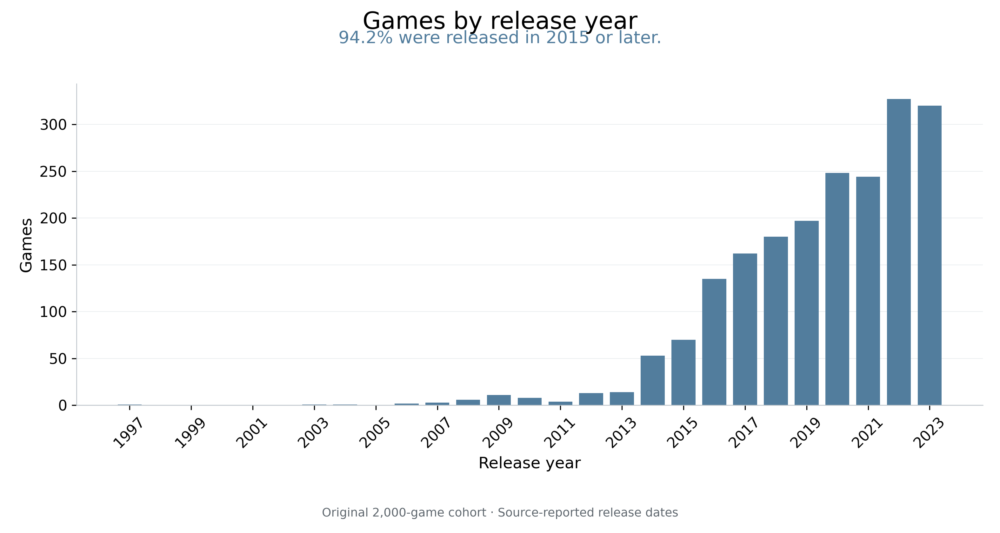
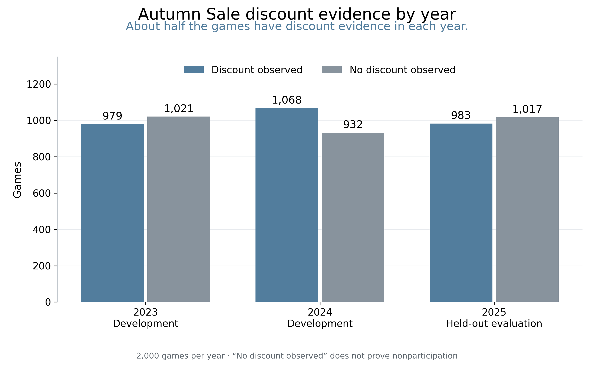
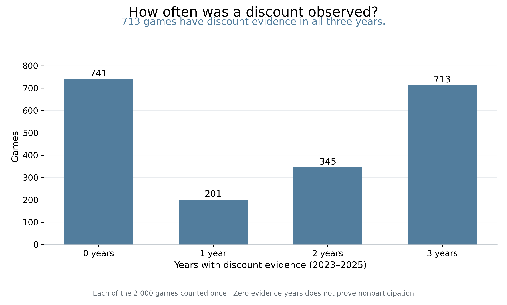
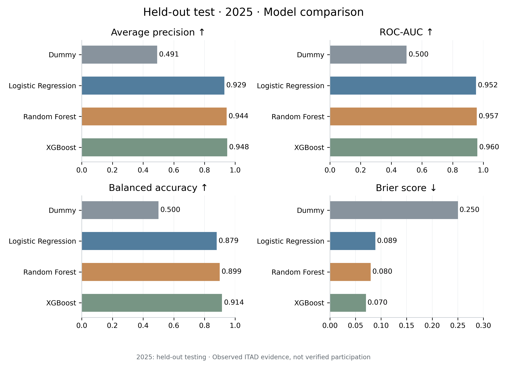
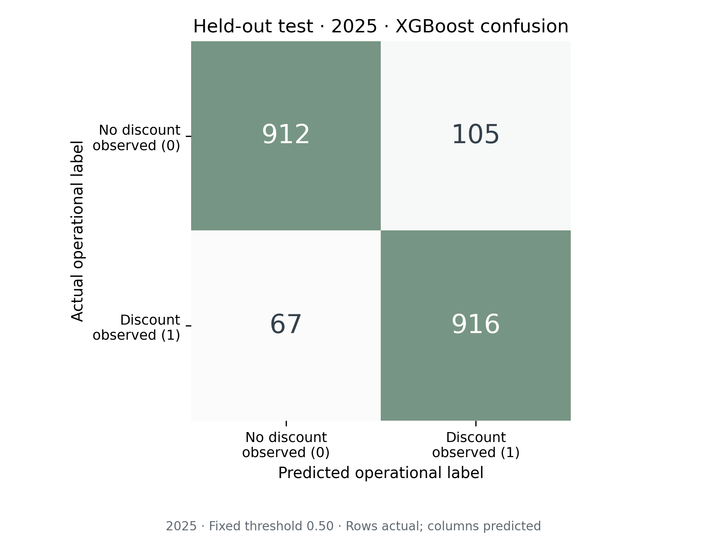
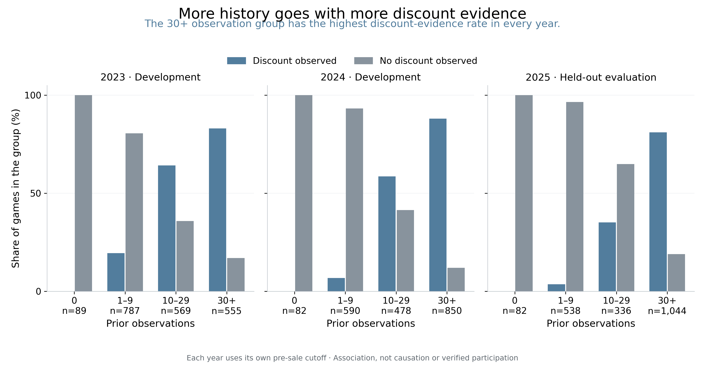
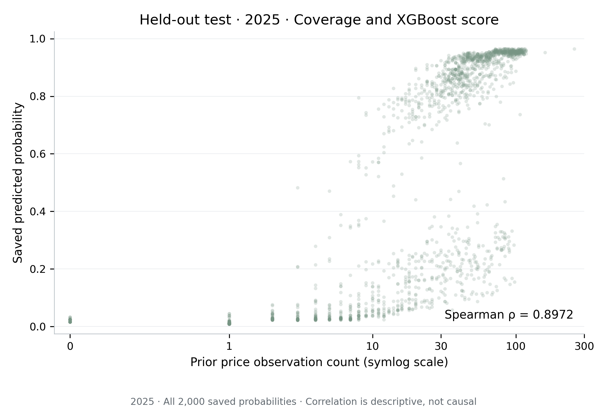
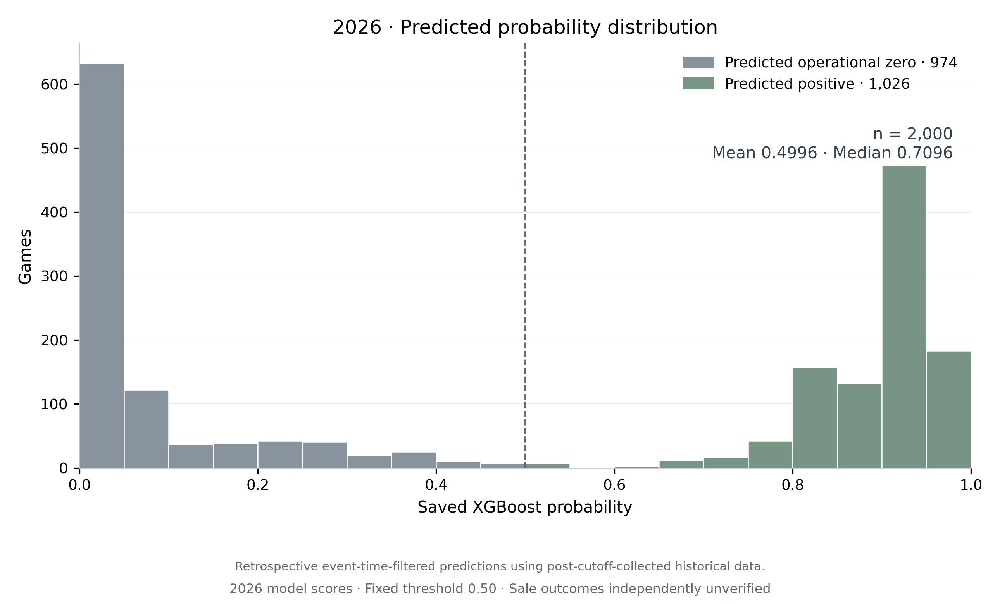
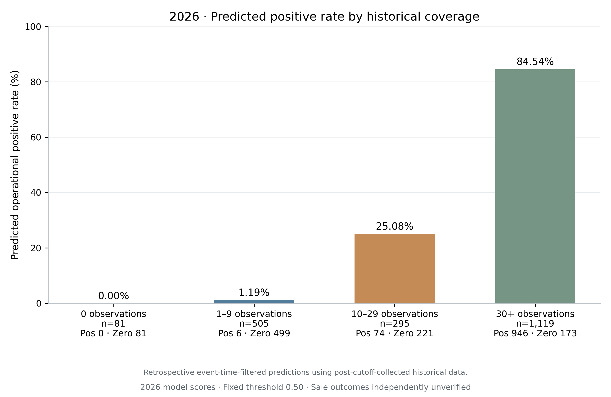
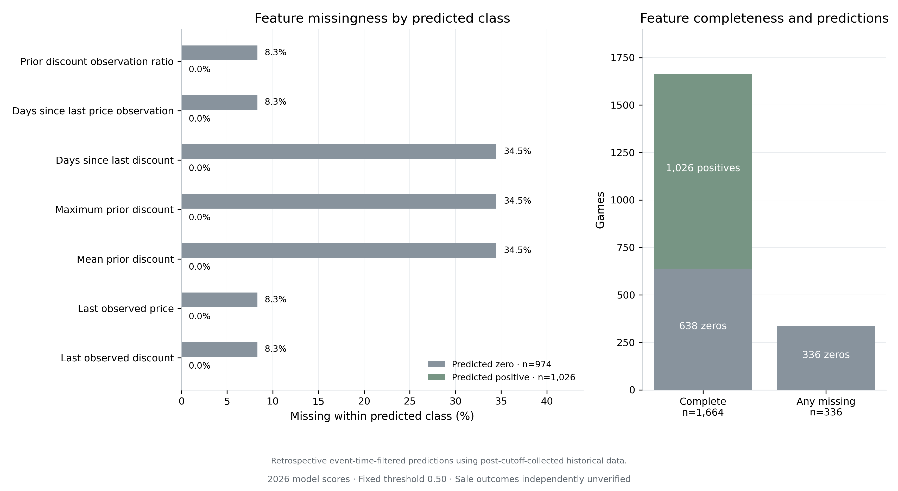

# Can Machine Learning Predict a Steam Sale? Here's What Happened When I Tried.

*An investigation into historical game prices, discount patterns, and the challenges of predicting Steam sales.*

This is the story of a completed retrospective investigation, told from the investigator's perspective. It draws on frozen project records rather than new experiments. The chapters follow the questions that made the project understandable; the [research timeline](research_timeline.md) preserves the actual order of the work. In particular, the exploratory charts introduced in Chapter 4 were made **after model development**, not used to choose features or improve the models.

## Chapter 1 — It Started with a Steam Sale

A Steam sale turns a familiar shopping question into a waiting game: buy now, or see whether a discount appears during the next event?

I wanted to know whether a game's pricing history could make that decision less mysterious. If a game had discounted frequently, if its last discount was recent, or if earlier discounts had been substantial, could a model recognize a useful pattern? The starting idea was straightforward: collect historical information, learn from earlier Autumn Sales, and check whether the pattern carried into a later one.

There was an immediate distinction to make. Predicting whether a game would have a qualifying Steam-store discount was different from predicting the depth of that discount, recommending the best purchase time, or establishing that the publisher formally enrolled in Valve's seasonal event. This project focused on the first question. It did not attempt the others.

Even that question depended on what could actually be measured. A historical database might record a discount, or it might contain nothing during the event. Those two situations sound like the beginning of a tidy yes/no problem. They would turn out to have very different evidential strength.

The investigation ultimately arrived at a more precise research question:

**Can information recorded before an Autumn Sale predict whether qualifying discount evidence will be recorded during that sale?**

That wording matters. It describes something the available data can support. Whether a game truly discounted at any moment during the entire sale is a broader claim, especially when the historical record has gaps.

The final experiment used the same frozen cohort of 2,000 games across the 2023, 2024 and 2025 Autumn Sales. XGBoost would later agree with the held-out 2025 operational labels 91.4% of the time. There would also be a set of 2026 scores. Neither result, on its own, would settle the shopper's original question.

To understand why, we need to start before the modeling—back when the project did not yet have a reliable table to feed it.

*Research trail: [project objective and scope](../../README.md), [frozen cohort modeling protocol](../cohort_2000_modeling/README.md). The top-level README contains earlier status snapshots; later phase-specific receipts establish the completed expansion described here.*

## Chapter 2 — Getting the Data Was the First Boss Fight

The project began with a large Steam metadata file: 125,855 entries, with identifiers, release dates, prices and many other fields. A large file was useful, but it was not yet a historical pricing dataset.

The first obstacle was unusually small: a missing comma. The source header had joined `Discount` and `DLC count` into one field, although the data rows contained both. Loading that file naively could shift the meaning of the columns. The inspection code supplied the corrected schema while preserving the original file. Before any sophisticated model could help, the project had to know which column was which.

Cleaning produced a catalog of 99,194 paid-game candidates. That name described a source-price filter, not a guarantee that every included title was always paid or every excluded title was permanently free. It was a sampling catalog, not the eventual modeling dataset.

More importantly, a price or review count in a snapshot was not automatically safe information for a historical prediction. If the snapshot was collected after the sale, it could reveal something that the model should not have known beforehand. The final predictors therefore would not use the metadata file's contemporary discount, popularity or review totals.

The first historical collection used a diagnostic pilot of 100 games. Its selection deliberately covered different release eras, price bands and unusual cases. It was designed to test the pipeline, not to estimate the behavior of the entire Steam catalog. IsThereAnyDeal supplied historical records scoped to the US and Steam storefront, identified as shop 61. Local copies of the responses—caches—kept the evidence available for later inspection. Each game first needed a matching provider identifier, followed by a history request.

The pilot accounted for every game: 97 returned nonempty histories and three returned successful empty histories. Those empty responses were already an important lesson. A successful request meant the collection completed; it did not mean a complete history existed, and an empty history did not demonstrate that a game had never discounted.

Expansion made the engineering challenge much more visible. The documented initial bounded ten-game test encountered timeout or connection failures, then an HTTP 403 response that stopped collection. The report did not establish the specific cause of that forbidden response. Subsequent recovery receipts show that the ten histories were eventually obtained, with earlier failed checkpoints preserved.

Later batches encountered HTTP 429 rate-limit responses too. Requests had to be paced, cooldowns respected, and interrupted work resumed without losing the accounting. Even three-second pacing did not guarantee a run would avoid rate limits. The response was a collector that could reuse completed caches, preserve partial lookup results, archive failed checkpoints and record attempts in an append-only journal. Successful games did not need to be downloaded again merely because another game failed.

The cohort grew through nested selections of 500, 1,000 and finally 2,000 games. The final cohort retained the original 100 diagnostic games and added 1,900 games from the pre-existing stratified sampling procedure. Selection was frozen independently of retrieval results; empty histories were not an invitation to substitute easier games.

The final expansion receipt records complete caches for all 2,000 games, no unresolved collection failures, and 81 successful empty histories. Its journal contains 3,816 HTTP attempts. That is the expansion journal's total, not a count of every request ever made during the project or its external source research.

Reproducibility here meant retaining the original responses, request settings, raw record indices and file hashes. It also meant keeping failure distinct from emptiness. That made it possible to inspect what the provider returned without quietly rewriting the evidence into a cleaner-looking story.

But even after collection completed, there was a question the API could not answer for us: what should count as “went on sale”?

*Research trail: [source inspection](../source_data_report.md), [catalog cleaning](../games_master_report.md), [pilot selection](../pilot_sample_report.md), [pilot collection](../itad_collection_report.md), [initial ten-game report](../../data/cohorts/runs/first_live_10/REPORT.md), [recovery receipt](../../data/cohorts/runs/first_live_10/recovery_20261012T192136Z/recovery_results.json), [final expansion receipt](../../data/cohorts/runs/2000_batch_004/collection_quality.json).*

## Chapter 3 — What Does “Went on Sale” Even Mean?

Imagine finding a record that says a game cost less than its regular price at a timestamp inside the sale window. That is direct evidence of a discount observation.

Now imagine finding a full-price record during the same event. It tells us the game was recorded at full price at that moment. It does not rule out a discount earlier or later in the week.

Finally, imagine finding no record during the event. The game might not have discounted. Or a discount might have occurred without appearing in the returned history. The absence of a row cannot choose between those possibilities.

The project investigated whether other sources could close that gap. An independent verification pilot examined 18 game-year pairs, including positive controls and difficult missing-evidence cases. Accessible pages and source documentation did not yield the relevant independent historical price observations needed to verify those pairs. No complete full-sale absence evidence was obtained. Access limitations were documented rather than treated as proof that the missing data did not exist anywhere.

This exposed an asymmetry. One valid recorded point can support the statement “a discount was observed.” Establishing “there was no discount at any time during the event” demands much more complete evidence. Surrounding full-price records alone were not enough, and the pipeline did not carry prices forward through unobserved intervals.

The project therefore used an explicit operational policy—a consistent rule for assigning labels to the evidence it had:

| Evidence category | What the available records say | Operational label |
| --- | --- | --- |
| A | At least one qualifying discount observed inside the sale window | 1 |
| B | In-window records exist and all show full price | 0 |
| D | No directly timestamped in-window records | 0 |
| C | In-window information is ambiguous, without a qualifying discount | Unknown |

The discount detector required valid finite monetary information, matching currency fields, a positive explicit discount percentage and a recorded price below the regular price. Event boundaries were exact: the start timestamp was included for labels, while the end timestamp was excluded.

For the 2,000-game experiment, A became the positive target and B/D became operational zeros. No C rows occurred in the frozen historical dataset. A separate earlier labelability audit had treated insufficient evidence more conservatively; its eligibility view was not silently substituted for the later frozen binary modeling target.

Calling B and D “operational zero” prevented a convenient shorthand from becoming an unsupported claim. The model was asked to predict the rule's recorded-evidence outcome. It was not supplied with independently verified labels for every game's actual sale participation.

This decision also changed the meaning of evaluation. When a prediction disagreed with an operational zero, that was a model error against the saved label. It did not independently prove the model had falsely predicted a real discount. Conversely, getting a sparse-record zero right could be easy without demonstrating much knowledge about the game's underlying pricing decisions.

The rule made a reproducible experiment possible. It also made the limitation part of the target itself, rather than a footnote we could add only after seeing the scores.

With that distinction established, we can meet the games—and see how uneven their available evidence actually was.

*Research trail: [historical ground-truth investigation](../autumn_sale_ground_truth_feasibility.md), [pilot operational labeling](../autumn_sale_operational_labeling.md), [cohort labelability audit](../cohort_2000_labelability/README.md), [frozen cohort labels](../cohort_2000_operational/README.md).*

## Chapter 4 — Meet Our 2,000 Games

This was a particular collection of games, not a miniature census of Steam. Its diagnostic pilot component, release eligibility and snapshot-based candidate selection all shaped who appeared in the cohort. A result about these games should not automatically become a claim about the whole storefront.

The release-year distribution makes that concrete. Most of the cohort consists of relatively recent releases: 1,883 games, or 94.2%, have source-reported release years of 2015 or later. The cohort spans 1997–2023, with 2022 the largest single release-year group at 327 games.

*Figure 1. Notice how strongly the cohort is concentrated in later release years. This describes the selected 2,000 games, not the release profile of all Steam games. Source: Phase 8D, Figure 01.*

Prices required a carefully chosen comparison. Rather than mix contemporary metadata prices with historical offers, Phase 8D used each game's last valid recorded USD price strictly before the 2025 sale cutoff. There were 1,918 usable prices; 82 were missing. Among the usable values, 75.9% were below $10 and the median was $5.54. Observed zeros and the $199.99 maximum were retained.

“Last recorded” is doing important work in that sentence. A record can be old. It is not necessarily the price at sale start, and it certainly is not a current shopping quote. Giving each game one price also avoids letting games with dense histories dominate this particular distribution.

Their historical record counts were uneven too. Before the 2025 cutoff, the median game had 32 valid price observations, the range was 0–256, and 82 games had none. These counts retained the source observations, including duplicates where present. They were not counts of separate sale campaigns or discounted days.

What did the Autumn Sale windows themselves show?

*Figure 2. The two bars are close in each year: about half the cohort has positive discount evidence. The gray bar combines full-price-only observations and absent in-window observations; it does not certify nonparticipation. Source: Phase 8D, Figure 04.*

The annual discount-observed counts were 979 in 2023, 1,068 in 2024 and 983 in 2025. Those are labels for different years of the same games. They are not three separate samples of the Steam population.

Looking across the years revealed another useful pattern. Some games had positive evidence repeatedly, while others never had a positive operational label in this panel.

*Figure 3. Each game contributes once. The sizable bars at zero and three years show repeated evidence patterns, while the middle groups capture changes across years. Zero evidence years is not proof that a game never discounted. Source: Phase 8D, Figure 05.*

The 0/1/2/3-year groups contained 741, 201, 345 and 713 games respectively. That distribution helped describe the panel, but it was not turned into a new “previous sale participation” predictor.

Discount size used a different unit: individual directly recorded discounts inside the historical sale windows. After excluding two conflicting same-time records from that descriptive chart, the supported sample contained 3,035 Steam/USD discount observations from 1,259 games. The median explicit discount percentage was 55%. More frequently recorded games carried more weight in that distribution; it was not a histogram of one typical discount per game. Full-price observations were excluded because the question was about the sizes of observed discounts.

Missing data also had a recognizable shape. Across the 6,000 historical game-year rows, seven of the approved predictors contained blanks. Three discount-derived predictors each had 1,134 missing cells; four price-history predictors each had 253. The other eight predictors were complete. A blank discount-recency value meant the required prior observation was unavailable, not that the last discount happened zero days ago.

There is a chronology catch in this chapter. These accessible EDA figures were produced in Phase 8D, after the models and 2026 predictions were frozen. I am presenting them here to make the dataset understandable. They did not steer feature selection, model tuning or the threshold. Reordering an explanation is fine; rewriting the history of the experiment would not be.

The dataset was now intelligible enough to ask how to learn from it while keeping tomorrow's information out of yesterday's inputs.

*Research trail: [EDA findings](../cohort_2000_eda/key_findings.md), [exact price/discount units](../cohort_2000_eda/data_sources.md), [historical missingness](../cohort_2000_modeling/missingness.csv).*

## Chapter 5 — Teaching a Model to Predict Discounts

A model needs clues about each game and an outcome to learn against. Here, the clues were summaries of release information and observations strictly before the relevant sale began. The outcome was the operational discount-evidence label during that sale.

There were 15 approved predictors. Four described reported release timing and game age. The remaining eleven described available price history: observation and discount counts, their ratio, time since the last price or discount record, largest and average earlier discounts, the last recorded price and discount, and two flags indicating whether prior price or discount observations existed. The [technical appendix](technical_appendix.md) lists every field and its definition.

The restriction was as important as the list. Game identifiers were used to join records, not as model inputs. Sale-year and evidence-category fields were not predictors. Neither were contemporary review totals, current metadata discounts or an added previous-sale participation label. The model could use available earlier pricing observations, but not a record at or after the predictor cutoff.

I compared four predefined approaches. The baseline ignored game-specific clues and assigned every game the training data's positive-label frequency. It was deliberately uninteresting: a model needed to improve on a benchmark that did not recognize any individual game.

Logistic Regression combined the clues into a weighted score and translated it into a probability. Random Forest combined many decision trees—small sequences of questions about the inputs—and averaged their responses. XGBoost also used trees, but built them sequentially so later trees could address errors left by earlier ones. These explanations describe how the methods work; none makes their output a guarantee about a future price.

Missing numerical inputs were handled inside the fitted pipelines using medians learned from training data. Logistic Regression also scaled its inputs using training statistics. The tree models did not require that scaling. Blank source values stayed blank in the frozen dataset; the saved preprocessing supplied the defined transformation when the models used them.

The time order of evaluation was crucial. Randomly mixing years could allow later behavior to inform an earlier prediction. Instead, development used 2023 to train and 2024 to compare the candidates. Once selection was locked, fresh versions of the predefined pipelines were fitted on 2023–2024 and evaluated on 2025.

| Stage | Information used to fit | Year used to assess |
| --- | --- | --- |
| Development | 2023: 2,000 game-year rows | 2024: 2,000 rows |
| Held-out evaluation | 2023–2024: 4,000 rows | 2025: 2,000 rows |

The selection rule emphasized how well a model ranked positive-evidence games toward the top. Its formal measure was **average precision**. XGBoost's 2024 value was 0.9445, ahead of Logistic Regression's 0.9383 and Random Forest's 0.9358. XGBoost was selected using that development result, **before the 2025 prediction pass**. Logistic Regression had better development accuracy and Brier score, so the selected model was not declared the winner of every possible metric.

There was one fixed configuration per candidate and a fixed 0.50 classification threshold. There was no search across settings to squeeze more out of the 2025 results, no fitted probability calibrator and no test-driven threshold adjustment.

The same 2,000 games appeared throughout. This was a test of predicting a later sale for previously represented games, not an evaluation on completely unseen titles. Also, 2025 labels had been summarized in earlier audits. They were excluded from this experiment's model-selection and fitting decisions, but the event was not an untouched confirmatory holdout.

Those qualifications leave a useful experiment intact. They define exactly which kind of success the next chapter can report.

*Research trail: [chronological protocol](../cohort_2000_modeling/temporal_split_manifest.json), [selection receipt](../cohort_2000_models/selection.json), [cohort model report](../cohort_2000_models/README.md), [frozen model cards](../cohort_2000_visualizations/model_card_xgboost.md). The earlier 100-game pilot models are separate from this cohort experiment.*

## Chapter 6 — 91.4% Accuracy. Sounds Great, Right?

The selected XGBoost pipeline agreed with 1,828 of the 2,000 held-out 2025 labels: an accuracy of 91.4%. Against the predefined baseline and the other learned models, that was a promising result.

It was also a sentence that needed its object: **91.4% accuracy against recorded operational evidence labels**, not independently verified real-world Autumn Sale participation.

The differences among models were visible across more than accuracy:

| Model | 2025 accuracy | Average precision | Brier score ↓ |
| --- | ---: | ---: | ---: |
| Training-prior baseline | 0.4915 | 0.4915 | 0.2503 |
| Logistic Regression | 0.8775 | 0.9293 | 0.0889 |
| Random Forest | 0.8985 | 0.9440 | 0.0798 |
| XGBoost | 0.9140 | 0.9479 | 0.0703 |

*Figure 4. The learned models improve substantially over the constant baseline on these evidence labels. XGBoost has the strongest reported held-out values in these panels, but the selection decision came from 2024, not this chart. For Brier score, shorter is better. Source: Phase 7B, held-out model comparison.*

The baseline's training prior was above the fixed threshold, so it classified every test game as positive. Its 49.15% accuracy reflected the fraction of positive labels in 2025, rather than skill at distinguishing games. The stronger models had learned game-specific patterns that the baseline could not use.

What does XGBoost's performance mean in ordinary language? Start with its actual agreements and disagreements:

*Figure 5. Rows are the saved evidence labels; columns are predictions. The diagonal contains agreements. Off-diagonal counts describe errors against those labels, not independently established mistakes about real sale participation. Source: Phase 7B, held-out XGBoost confusion matrix.*

It identified 916 of the 983 positive-evidence games, missing 67. Among the 1,017 operational-zero games, it predicted zero for 912 and positive for 105. “Positive” in this account always refers to the recorded-evidence target.

The remaining metrics look more approachable when read as questions:

| Metric | Frozen 2025 value | Plain-English question |
| --- | ---: | --- |
| Accuracy | 0.9140 | How often did the predicted class match the recorded label? |
| Balanced accuracy | 0.9143 | How well did it recognize each class, giving both equal weight? |
| Precision | 0.8972 | Of the games predicted positive, how many had positive evidence labels? |
| Recall | 0.9318 | Of the games with positive evidence labels, how many did it find? |
| F1 | 0.9142 | How strong was the combined precision/recall result? |
| ROC-AUC | 0.9603 | How well did scores rank positives above zeros across thresholds? |
| Average precision | 0.9479 | How well did the ranking retain precision while finding more positives? |
| Brier score | 0.0703 | How close were the probabilities to the recorded zero/one labels? |

Precision and recall highlight different costs. Precision asks whether a positive recommendation has supporting evidence; recall asks how much positive evidence the model misses. F1 summarizes their balance using a harmonic mean, which penalizes a weak side. Balanced accuracy separately averages recognition of the positive and zero classes.

ROC-AUC and average precision concern score ordering, rather than agreement at one threshold. Their high values do not mean that a game with a particular score has that exact chance of a real discount. Brier score considers the probabilities themselves through squared error; lower is better. Its improvement over the baseline is useful evidence about probability error on these labels, not a promise of calibration in 2026.

For this recorded target and these repeated games, the model had meaningful predictive signal. But an aggregate result can hide where that signal is strongest—and where apparently excellent accuracy answers an easier question than we intended.

*Research trail: [unrounded held-out metrics](../cohort_2000_models/held_out_metrics.json), [selection timing and criteria](../cohort_2000_models/selection.json), [Phase 7B diagnostics](../cohort_2000_visualizations/README.md).*

## Chapter 7 — The Plot Twist: Our Data Might Be Telling Two Stories

The investigation had always been about game prices. The diagnostics suggested that it was also about how well those prices were recorded.

That connection is plausible under the target definition. More historical records can reflect genuine pricing activity, better provider coverage, or both. More opportunities to observe prices can also go with more opportunities to record an in-sale discount. Yet the label rule assigns an operational zero when there is no in-window observation. The observed behavior and the observation process are intertwined.

We can see their association without claiming which mechanism dominates:

*Figure 6. Every year uses its own pre-sale record counts. The densely observed group has the highest positive-evidence rate in each panel. Notice the sample sizes and separate development/held-out years; these bars do not establish that recording density causes discounts. Source: Phase 8D, Figure 07.*

In 2025, positive operational-label rates rose from 0% in the zero-observation group to 3.53%, 35.12% and 81.03% in the 1–9, 10–29 and 30+ groups. Those are rates of recorded evidence, with year-appropriate historical coverage—not independently verified participation rates.

The model scores followed a strong related pattern. Games with larger historical observation counts generally had higher XGBoost scores. The saved 2025 score/count Spearman correlation was 0.8972. Spearman compares rankings: a value this high means the ordering by observation count and the ordering by score tended to move together.

*Figure 7. Each dot is a saved score for one game. Moving right generally goes with moving upward. The compressed count axis includes zero; it changes spacing, not the observations. The association is strong, but dots alone cannot explain its cause. Source: Phase 7B, held-out coverage/probability diagnostic.*

A sparse subgroup illustrates why overall accuracy needed company. Among the 538 games with 1–9 prior observations, only 19 had positive labels. XGBoost's subgroup accuracy was 97.2%, yet it detected just seven of those positives and missed twelve. That is high agreement dominated by the much larger zero class, alongside limited detection of the rare positive evidence.

The zero-history group was even easier to misread: all 82 games had zero operational labels and zero predictions. Perfect agreement in a single-class group does not verify the absence of actual discounts, and metrics requiring both classes cannot supply meaningful evidence there.

Missing predictors were part of the same investigation. When there was no qualifying prior discount record, discount recency and size summaries could not be calculated. Those blanks traveled with limited historical evidence; they were not verified negative outcomes. Training-only median imputation allowed the existing models to process them, but it did not create the observations that were missing.

There are two explanations we should resist. One says the model learned only data availability and nothing about pricing behavior. The other says coverage is irrelevant because accuracy is high. Neither follows from these results. Count, recency and discount-history features are related, and the observed associations do not separate their causes or uniquely attribute the model's signal.

The later 2026 scores also had a strong coverage correlation, 0.8925. That was a descriptive continuation of the pattern, not a fresh performance test or a controlled experiment about drift. The training period and subgroup composition differed.

No coverage diagnostic prompted a new threshold, a revised label or a replacement model. The important discovery was about interpretation: a useful predictor of recorded evidence can still leave the underlying sale-participation question partly unanswered.

That distinction became decisive when it was time to ask what “next sale prediction” could honestly mean.

*Research trail: [2025 subgroup diagnostics](../cohort_2000_visualizations/coverage_summary.csv), [historical evidence/coverage counts](../cohort_2000_eda/coverage.csv), [2026 score/coverage and missingness findings](../cohort_2000_2026_visualizations/key_findings.md).*

## Chapter 8 — So, Can We Predict the Next Steam Sale?

The 2026 exercise began with a feasibility audit, not an assumption that the historical pipeline could simply be pointed at a new year. Its feature cutoff was **2026-10-01T17:00:00Z**, the verified sale-start boundary in the frozen calendar evidence. Records at the boundary, inside the sale or later could not enter the predictors.

There was a practical compatibility issue too. An older historical wrapper stopped records at January 1, 2026. Reusing it would have discarded valid observations from the months before the October cutoff. Phase 8B instead supplied the full histories and explicit 2026 window to the unchanged feature core, keeping the original definitions and preserving the earlier artifacts.

For the existing prediction run, a separately saved XGBoost pipeline was fitted on all 6,000 frozen 2023–2025 rows, using the already selected configuration and fresh training-only median preprocessing. No 2026 outcome labels entered training or model selection. This was a new historical refit for the later event, not the earlier 2023–2024 fit whose 2025 performance we reported. Its old held-out score cannot be transferred to the new refit as if that refit had been independently evaluated.

The saved output covered exactly the original 2,000 games:

- **1,026 predicted positives: 51.3%.**
- **974 predicted operational zeros: 48.7%.**
- **Mean probability: 0.4996; median probability: 0.7096.**

*Figure 8. The average score near one-half does not mean every game is a coin flip. Many saved scores are near the low or high end. The dashed threshold is unchanged; the distribution itself does not demonstrate probability calibration. Source: Phase 8C, Figure 01.*

The coverage breakdown remained striking. The zero-history group had no predicted positives. At the other end, the 30+ group supplied most of them. The numerical detail belongs with the denominator, so that a high predicted rate is not mistaken for an observed outcome:

*Figure 9. The predicted class rate changes sharply with historical coverage. Read these as model outputs for the listed groups, not actual sale participation rates. Source: Phase 8C, Figure 06.*

The four groups partition the original cohort without adding games. The [appendix](technical_appendix.md) preserves the full counts and rates for reference. The contrast with Chapter 4's historical evidence chart is deliberate: the earlier bars summarize labels; these bars summarize predictions.

The missingness result was equally clear in the saved data. All 336 games with missing predictors received predicted operational zero. Of those, 255 lacked three discount-derived values, while 81 had seven missing values associated with no valid prior price history. Their observed price-record counts ranged from zero to four.

That did not mean a blank cell proved the game would not discount. Nor did completeness guarantee a positive prediction: 638 other predicted zeros had complete feature vectors.

*Figure 10. The incomplete-vector group is entirely predicted zero, but many complete-vector games are also predicted zero. Missingness is associated with the model output and sparse history; it is not verified nonparticipation. Source: Phase 8C, Figure 08.*

The strongest limitation, however, concerned time. Every historical cache receipt used in the 2026 exercise was collected after the feature cutoff, during October 5–13. A record's timestamp could say a price observation occurred before October 1 without proving that the provider already held that exact record before October 1.

A later response might contain backfilled or corrected history. It might also faithfully contain records that were available earlier. The project cannot establish which from these receipts. There are no demonstrated pre-cutoff snapshots proving the complete input vectors were available then. That is a lack of evidence for prior availability, not proof of prior unavailability.

The correct description is therefore:

**Retrospective event-time-filtered predictions using post-cutoff-collected historical data.**

These are not genuine prospective forecasts. Pre-cutoff provider availability cannot be established. **No independently verified 2026 outcome evaluation has been conducted.** The saved scores and classes are neither verified outcomes nor evidence that the old 91.4% result carried into 2026.

So, can machine learning predict a Steam sale? This project supports a narrower, useful answer: **historical release and pricing-observation summaries predicted later recorded Autumn Sale discount evidence well for the same 2,000 games in the frozen 2025 experiment.** It does not establish reliable prospective prediction of independently verified sale participation, completely unseen games or the whole Steam catalog.

A stronger prospective claim would require genuinely pre-sale input snapshots and suitable independent outcome evidence. Those are requirements identified by the investigation, not new experiments conducted here. The coverage and missingness findings make it especially important to understand the observation process as well as the model.

There is also a small but concrete provenance caveat. The project retains a known historical evidence-file ordering mismatch, plus a separately documented Phase 8B prediction CSV discrepancy involving row order and two game-name edits. Phase 8C reproduced the original prediction manifest hash by restoring only order/names in memory, establishing that scores, classes and cohort IDs were unchanged. This synthesis preserves the files and documents both issues; it does not repair them or treat the edited names as new cohort members.

I started with a prediction question. The result was a working retrospective model, a carefully qualified set of later scores, and a better understanding of what their target meant. The most useful lesson was that a convincing performance number still needs an honest account of the evidence underneath it. That is what makes the result worth sharing—and what keeps it from promising more than the project actually learned.

*Research trail: [2026 feasibility and provenance](../cohort_2000_2026_feasibility/README.md), [frozen 2026 run](../cohort_2000_2026_predictions/README.md), [prediction summary](../cohort_2000_2026_predictions/prediction_summary.json), [coverage](../cohort_2000_2026_predictions/coverage.csv), [integrity caveat](../cohort_2000_2026_visualizations/source_integrity_notes.json). See the [technical appendix](technical_appendix.md) for configurations, exact cutoffs and source mapping, and the [executive summary](executive_summary.md) for a shorter shareable version.*
